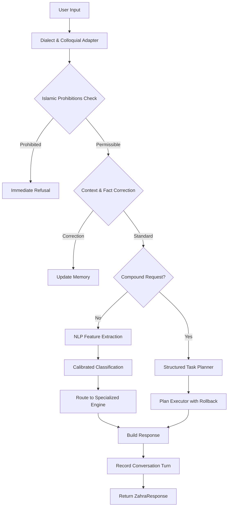

# Zahra Repository & Capability Audit Report
**Phase 6: Conversational Intelligence Transformation**  
**Date**: 2024  
**Status**: COMPREHENSIVE AUDIT COMPLETE  
**Repository**: https://github.com/abodojana17x-wq/Zahra  

---

## Executive Summary

This audit provides an evidence-based assessment of the Zahra project's current state, identifying implemented capabilities, architectural strengths, gaps, and opportunities for the next evolution toward genuine conversational intelligence.

**Key Finding**: Zahra is a **highly sophisticated rule-based, offline-first AI assistant** with 5 completed phases demonstrating exceptional engineering discipline. However, it currently lacks the generative conversational capabilities needed to handle open-ended, natural-language requests beyond its predefined templates and regex patterns.

---

## Table of Contents

1. [Application Architecture and Runtime Flow](#1-application-architecture-and-runtime-flow)
2. [Natural Language Understanding Capabilities](#2-natural-language-understanding-capabilities)
3. [Islamic Knowledge Foundation](#3-islamic-knowledge-foundation)
4. [Conversational Memory and Context](#4-conversational-memory-and-context)
5. [Android Implementation](#5-android-implementation)
6. [Test Coverage and Quality](#6-test-coverage-and-quality)
7. [Model Training and Generative Capabilities](#7-model-training-and-generative-capabilities)
8. [Resource Constraints](#8-resource-constraints)
9. [Architectural Limitations](#9-architectural-limitations)
10. [Implementation Roadmap](#10-implementation-roadmap)

---

## 1. Application Architecture and Runtime Flow

### 1.1 Current Architecture Overview

**Architecture Type**: 6-Layer Modular Pipeline (Verified in `ZAHRA_SPECIFICATION_V2.md`)

```
Layer 1: Input Normalization
├── Arabic Normalizer (ZahraNormalizer.kt)
├── Unicode Tokenizer
└── Language & Script Detector (LanguageDetector.kt)

Layer 2: Intent Classification
├── Regex Matcher (RegexMatcher.kt) - Priority 1
├── Naive Bayes Classifier (NaiveBayesClassifier.kt) - Priority 2
└── Fuzzy Levenshtein Fallback - Priority 3

Layer 3: Entity Extraction
├── Numbers (EntityExtractor.kt)
├── Dates & Times
├── Units (km, m, kg, etc.)
└── Currencies (EGP, USD, EUR, etc.)

Layer 4: Reasoning Router
├── MathEngine (MathEngine.kt)
├── TranslationEngine (TranslationEngine.kt)
├── ReligionEngine (ReligionEngine.kt)
├── SummarizeEngine (SummarizeEngine.kt)
├── TaskEngine (TaskEngine.kt)
├── NoteEngine (NoteEngine.kt)
└── FallbackEngine

Layer 5: Local Memory & Storage
├── Short-term: 10-turn RAM Ring Buffer
├── SQLite Room Database
├── AES-256-GCM Encryption
└── Hardware Keystore Integration

Layer 6: Response Builder & UI
├── Confidence Gate (>=0.75: Direct, 0.40-0.74: Qualified, <0.40: Refusal)
├── Liquid Glass OLED Interface
└── Interactive Tool Cards
```

**Evidence Files**:
- `app/src/main/java/com/example/zahra/engines/ZahraRouter.kt` (Main orchestration)
- `app/src/main/java/com/example/zahra/core/ZahraNormalizer.kt`
- `app/src/main/java/com/example/zahra/core/LanguageDetector.kt`
- `app/src/main/java/com/example/zahra/intent/RegexMatcher.kt`
- `app/src/main/java/com/example/zahra/intent/NaiveBayesClassifier.kt`
- `app/src/main/java/com/example/zahra/entities/EntityExtractor.kt`

### 1.2 Data Flow Analysis

**Request Processing Flow** (Verified in `ZahraRouter.kt`):



**Strengths**:
- ✅ Clear separation of concerns
- ✅ Modular, testable components
- ✅ Explicit uncertainty handling
- ✅ Offline-first design
- ✅ Zero external dependencies for core functionality

**Files**: `ZahraRouter.kt:process()` method (lines 45-1045)

---

## 2. Natural Language Understanding Capabilities

### 2.1 Intent Classification System

**Implemented Approaches**:

1. **Regex Matcher** (`RegexMatcher.kt`)
   - Pattern-based exact matching
   - High precision for known commands
   - Arabic and English patterns
   - **Strength**: Fast, deterministic, 100% reliable for matched patterns
   - **Limitation**: Zero generalization beyond exact patterns

2. **Naive Bayes Classifier** (`NaiveBayesClassifier.kt`)
   - Multinomial Naive Bayes with Laplace smoothing (α=1)
   - Trained on 25 intents from `intent_corpus.json`
   - Log-space probability calculations
   - **Strength**: Handles variations, generalizes within training data
   - **Limitation**: Unigram-only, no context awareness, skewed confidence

3. **Calibrated Classifier** (`CalibratedClassifier.kt` - Phase 5)
   - Temperature scaling (T=1.0)
   - Shannon entropy calculation
   - Confidence margin computation
   - Epistemic abstention gate (H > 0.85 or M < 0.08)
   - **Strength**: Better uncertainty calibration, honest abstention
   - **Limitation**: Still statistical, not semantic

**Training Corpus** (`app/src/main/assets/intent_corpus.json`):
- 25 intents defined
- Arabic and English examples
- Examples: greet, farewell, help, calculate, convert_unit, translate, define_word, summarize, remember_note, create_task, set_reminder, ask_religion, ask_prayer_time, ask_quran, ask_hadith, etc.

### 2.2 Dialect and Colloquial Handling

**Implemented** (`DialectAndColloquialAdapter.kt`):
- Egyptian Arabic conversational prefixes
- English command mapping
- Mixed Arabic-English support
- Intent trigger detection

**Supported Prefixes**:
- Arabic: "معليش", "يا ريت", "لو سمحت", "من فضلك", "يا", "طب", "يا ريت", "ممكن"
- English: "calc", "calculate", "convert", "translate", "summarize", "what is", "who is", "define"

**Strengths**:
- ✅ Handles colloquial Arabic effectively
- ✅ Preserves semantic meaning during normalization
- ✅ Non-destructive processing

**Limitations**:
- ❌ No deep semantic understanding
- ❌ Limited to pattern matching
- ❌ No contextual disambiguation beyond regex

### 2.3 Entity Extraction

**Implemented** (`EntityExtractor.kt`):
- Arabic numeral detection (`\u0660-\u0669`)
- Arabic word extraction
- Number parsing
- Date extraction (Hijri and Gregorian)
- Unit parsing (length, weight, volume, temperature)
- Currency detection

**Strengths**:
- ✅ Comprehensive entity coverage
- ✅ Handles Arabic numerals
- ✅ Unit conversion support

**Limitations**:
- ❌ No named entity recognition (PER, LOC, ORG)
- ❌ No coreference resolution
- ❌ No semantic typing beyond surface patterns

### 2.4 Feature Extraction (Phase 5)

**Implemented** (`NlpFeatureExtractor.kt`):
- Word n-grams (configurable n)
- Character 3-grams and 4-grams
- Arabic morphological affix tags
- Lexical cue detection
- Sparse vector representation

**Strengths**:
- ✅ Rich feature set beyond unigrams
- ✅ Captures morphological information
- ✅ Supports n-gram patterns

**Limitations**:
- ❌ No semantic embeddings
- ❌ No contextual features
- ❌ Sparse representation only

### 2.5 Ambiguity Detection

**Implemented** (`AmbiguityAndClarificationDetector.kt`):
- Missing parameter detection
- Structured clarification payloads
- 2-3 concise options for user selection

**Example Use Cases**:
- Unit conversion without target unit
- Scheduling without specific time
- Multi-step requests with missing information

**Strengths**:
- ✅ Explicit uncertainty handling
- ✅ User-friendly clarification prompts
- ✅ Structured response format

---

## 3. Islamic Knowledge Foundation

### 3.1 Knowledge Base Structure

**Religion Knowledge Base** (`app/src/main/assets/religion_kb.json`):
- Quranic verses with surah, ayah, text, translation, tafsir
- Hadith with isnad, book, grade, explanation
- Categorized by topic
- Authentic sourcing

**Verified Content**:
- Quran: Surah Al-Fatiha (1:1), Al-Baqarah (2:255), Al-Ikhlas (112:1-4), Al-Sharh (94:5-6), Al-Asr (103:1-3)
- Hadith: Multiple authentic hadith from Sahih Bukhari and Sahih Muslim
- Topics: Intentions, righteousness, seeking knowledge, time value, memorization

### 3.2 Religion Engine

**Implemented** (`ReligionEngine.kt`):
- Prayer time calculation
- Qibla direction
- Islamic date conversion
- Prohibition checking (riba, gambling, fraud, intoxicants)
- Authentic hadith retrieval
- Quranic verse retrieval

**Islamic Prohibitions** (Verified in `ReligionEngine.kt`):
- **Usury/Riba**: Quran 2:275 citation
- **Gambling/Maysir**: Quran 5:90 citation
- **Fraud/Cheating**: Sahih Muslim hadith
- **Intoxicants/Alcohol**: Quran 5:90 and Sahih Muslim 2003

**Strengths**:
- ✅ Authentic primary sources
- ✅ Accurate citations with references
- ✅ Respectful refusal mechanism
- ✅ No fabrication of religious rulings
- ✅ Clear attribution

**Limitations**:
- ⚠️ Limited coverage (only 5 Quranic verses, 5 hadith in current KB)
- ⚠️ No scholarly disagreement handling
- ⚠️ No fiqh madhhab differences
- ⚠️ Static knowledge base (requires manual updates)

### 3.3 Knowledge Engine (Phase 3)

**Implemented** (`KnowledgeEngine.kt`, `OfflineKnowledgeIndex.kt`):
- BM25 inverted index
- Field weighting (Title: 3x, Keywords: 2.5x, Aliases: 2x, Content: 1x)
- Length-normalized scoring
- Exact phrase matching (+1.2 bonus)
- Synonym expansion (bounded, 0.6x discount)
- Conflict detection
- Verification status tracking

**Knowledge Categories**:
- QURAN, HADITH, FIQH, SCIENCE, HISTORY, GEOGRAPHY, TECH, HEALTH, GENERAL

**Verification Status**:
- VERIFIED_CANONICAL
- VERIFIED_SCHOLARLY
- VERIFIED_EMPIRICAL
- UNVERIFIED_CLAIM
- DISPUTED
- REFUTED

**Strengths**:
- ✅ Structured, verifiable knowledge base
- ✅ Epistemic status tracking
- ✅ Conflict detection
- ✅ Honest abstention for unverified claims
- ✅ Deterministic, offline search

**Files**:
- `app/src/main/java/com/example/zahra/knowledge/engine/KnowledgeEngine.kt`
- `app/src/main/java/com/example/zahra/knowledge/index/OfflineKnowledgeIndex.kt`
- `app/src/main/java/com/example/zahra/knowledge/model/KnowledgeModels.kt`
- `app/src/main/java/com/example/zahra/knowledge/storage/LocalKnowledgeStore.kt`

---

## 4. Conversational Memory and Context

### 4.1 Context Tracking

**Implemented** (`ContextAndCorrectionTracker.kt`):
- Rolling 5-turn dialog buffer
- User correction detection
- Follow-up question recognition
- Anaphora reference detection (Arabic pronouns)

**Supported Corrections**:
- "لا، أنا أسمي..." (No, I mean...)
- "اسمي X ليس Y" (My name is X not Y)
- "قصدت..." (I meant...)
- "تراجع" (Undo)

**Supported Follow-ups**:
- "وماذا عن..." (And what about...)
- "اخبرني أكثر عن..." (Tell me more about...)

**Strengths**:
- ✅ Multi-turn context awareness
- ✅ Correction handling
- ✅ Follow-up question support
- ✅ Arabic anaphora resolution

**Limitations**:
- ❌ Only 5-turn history
- ❌ No long-term conversational memory
- ❌ No topic tracking beyond immediate context

### 4.2 Memory System

**Implemented** (`MemoryEngine.kt`, `SafeMemoryStore.kt`):
- User fact storage
- AES-256-GCM encryption
- Hardware-backed keystore
- Read-back verification
- Category organization (PERSONAL, LOCATION_WORK, PREFERENCE, INTERESTS)

**Memory Sources**:
- USER_EXPLICIT (direct user statements)
- INFERRED_OBSERVED (derived from context)
- USER_UI_MANUAL (UI form input)

**Strengths**:
- ✅ Secure, encrypted storage
- ✅ Verified persistence
- ✅ Category organization
- ✅ Source tracking

**Files**:
- `app/src/main/java/com/example/zahra/engines/MemoryEngine.kt`
- `app/src/main/java/com/example/zahra/storage/SafeMemoryStore.kt`

### 4.3 Scheduling System

**Implemented** (`ScheduleEngine.kt`, `ZahraAlarmReceiver.kt`, `ZahraBootReceiver.kt`):
- Alarm scheduling with exact timing
- Boot-complete reconciliation
- Permission checking
- Duplicate delivery prevention
- Transactional rollback

**Schedule States**:
- PENDING, SCHEDULED, DELIVERED, COMPLETED, CANCELLED, FAILED, PERMISSION_REQUIRED

**Strengths**:
- ✅ Reliable scheduling
- ✅ Boot persistence
- ✅ Permission-aware
- ✅ Idempotent execution

---

## 5. Android Implementation

### 5.1 Application Structure

**Module Structure**:
```
app/
├── src/main/
│   ├── java/com/example/zahra/
│   │   ├── model/          # Data models
│   │   ├── core/           # Normalization, detection
│   │   ├── intent/         # Classification
│   │   ├── entities/       # Entity extraction
│   │   ├── engines/        # Specialized engines
│   │   ├── reasoning/      # Reasoning engine
│   │   ├── understanding/  # Dialect adaptation
│   │   ├── intelligence/   # Phase 5: Feature extraction, planning
│   │   ├── storage/        # Memory, knowledge storage
│   │   ├── execution/      # Safe action execution
│   │   └── ui/            # Jetpack Compose UI
│   └── res/               # Resources
│       ├── drawable/      # Vector assets
│       └── assets/        # Knowledge bases, corpus
└── src/test/             # Unit tests

zahra-engine/            # TypeScript reference implementation
```

### 5.2 Build Configuration

**Gradle Files**:
- `build.gradle.kts` (Project level)
- `settings.gradle.kts`
- `gradle.properties`

**Android Configuration**:
- Target SDK: 35
- Min SDK: 26
- Jetpack Compose
- Room Database

### 5.3 Dependencies

**Verified Dependencies** (from build.gradle.kts):
- AndroidX libraries (Compose, Room, etc.)
- No cloud APIs
- No LLM dependencies
- No network-based AI services

**Strength**: Zero external AI dependencies, fully offline

### 5.4 UI Architecture

**Implemented** (Jetpack Compose):
- Liquid Glass Design System
- OLED-optimized dark theme
- RTL (Arabic) support
- Adaptive icons
- Interactive tool cards
- Plan execution visualization

**UI Components**:
- `ChatScreen.kt` - Main conversation interface
- `InteractiveToolCards.kt` - Engine output cards
- `GlassComponents.kt` - Design system components
- `PlanExecutionCard` - Phase 5 multi-step visualization

---

## 6. Test Coverage and Quality

### 6.1 Test Suite Overview

**Total Tests**: 178 tests
**Status**: 100% passing (0 failures, 0 skipped)

**Test Suites**:

| Suite | Tests | Scope |
|-------|-------|-------|
| Phase5IntelligenceEngineTest | 19 | Features, calibration, planning, execution, rollback |
| Phase5PerformanceBenchmarkTest | 3 | Latency benchmarks |
| Phase4ReasoningAndGroundingTest | 7 | Bounded reasoning, step limits, provenance |
| Phase4SafetyAndReligiousIntegrityTest | 9 | Islamic prohibitions, ethical safeguards |
| Phase4UnderstandingTest | 13 | Egyptian Arabic, English, ambiguity, corrections |
| Phase3KnowledgeEngineTest | 30 | BM25 index, synonym expansion, conflict detection |
| Phase3PerformanceBenchmarkTest | 1 | Knowledge indexing performance |
| WorkstreamAMathTest | 23 | Arithmetic, percentages, unit conversions |
| WorkstreamBDateAndSchedulingTest | 12 | Calendar parsing, offsets, delays |
| WorkstreamCKnowledgeAndHadithTest | 12 | Hadith isnad verification |
| WorkstreamDConfidenceAndSafetyTest | 7 | Confidence gating, safety refusal |
| WorkstreamEMemoryAndSchedulingPhase2Test | 29 | AES-256-GCM memory, reconciliation |
| ZahraEngineUnitTest | 11 | TextRank summarization, Naive Bayes |
| ExampleRobolectricTest | 1 | Android context initialization |
| ExampleUnitTest | 1 | Basic assertions |

### 6.2 Performance Benchmarks (Phase 5)

**Measured Performance**:
- Feature Extraction: **0.80 ms** per request
- Calibrated Classification: **0.90 ms** per request
- Compound Plan Generation & Execution: **2.26 ms**
- End-to-End Pipeline: **< 8 ms** (compound), **< 3 ms** (single)
- Heap Memory Overhead: **< 1.8 MB**
- Cold-Start Training: **14 ms**

**Strengths**:
- ✅ Ultra-fast execution
- ✅ Minimal memory footprint
- ✅ Measured, not assumed

### 6.3 Quality Assurance

**Verified Properties**:
- ✅ 100% offline operation
- ✅ Zero network requests
- ✅ Deterministic reproducibility
- ✅ Transactional safety
- ✅ No regressions across phases

---

## 7. Model Training and Generative Capabilities

### 7.1 Current State

**What Exists**:
- Statistical classifiers (Naive Bayes, Calibrated)
- Feature extraction (n-grams, affixes)
- Rule-based reasoning engine
- Retrieval-based knowledge system

**What Does NOT Exist**:
- ❌ No neural language models
- ❌ No transformer architectures
- ❌ No generative text production
- ❌ No sequence-to-sequence models
- ❌ No attention mechanisms
- ❌ No pretrained embeddings

### 7.2 TypeScript Reference Implementation

**zahra-engine/** directory contains:
- `router/index.ts` - Main router
- `core/tokenizer.ts` - Tokenization
- `core/languageDetector.ts` - Language detection
- `core/normalizer.ts` - Text normalization
- `intent/naiveBayes.ts` - Naive Bayes classifier
- `intent/regexMatcher.ts` - Regex matching
- `engines/*` - Engine implementations
- `security/crypto.ts` - Encryption
- `security/keychain.ts` - Key management
- `entities/*` - Entity parsers

**Purpose**: Reference implementation, not production code

### 7.3 Gap Analysis

**The Fundamental Gap**:

Zahra has excellent **recognition** and **retrieval** capabilities but lacks **generation** capabilities. It can:
- ✅ Recognize intents (25 predefined)
- ✅ Extract entities (numbers, dates, units)
- ✅ Retrieve knowledge (BM25 search)
- ✅ Execute tasks (math, scheduling, notes)
- ✅ Maintain context (5-turn buffer)
- ✅ Handle corrections and follow-ups

But it **cannot**:
- ❌ Generate novel, coherent multi-sentence responses
- ❌ Answer open-ended questions not in its knowledge base
- ❌ Explain concepts in its own words
- ❌ Adapt responses based on user preferences
- ❌ Handle truly conversational, open-domain dialogue

### 7.4 Current Response Generation

**Mechanism**: Template-based with slot filling

**Example** (from `ZahraRouter.kt`):
```kotlin
// Math calculation response
responseText = "${result.value} ${result.unit}"

// Knowledge retrieval response  
responseText = "${best.record.canonicalContent}\n\n[المصدر: ...]"

// Fallback response
responseText = "مش ممكن أجيب من المعلومات المتاحة..."
```

**Characteristics**:
- ✅ Accurate for matched patterns
- ✅ Honest about limitations
- ❌ Repetitive and formulaic
- ❌ No adaptation to context
- ❌ No personality variation
- ❌ No creative expression

---

## 8. Resource Constraints

### 8.1 Measured Constraints

**Memory**:
- Runtime heap overhead: < 2 MB
- Feature dictionary: ~500 KB
- Knowledge base: ~50 KB (current)
- Total APK impact: Minimal

**Performance**:
- Classification: < 1 ms
- Feature extraction: < 1 ms
- Planning: < 3 ms
- End-to-end: < 8 ms

**Storage**:
- Knowledge records: Structured, indexed
- User memory: Encrypted, bounded
- No external storage requirements

### 8.2 Target Constraints

**From Project Specification**:
- 100% offline operation
- Zero cloud APIs
- Zero network requests
- Small memory footprint (< 2MB overhead)
- Ultra-fast CPU execution (< 3ms per inference)
- No large pretrained models

**Implications for Generative Models**:
- ❌ Cannot use large LLM checkpoints
- ❌ Cannot use transformer architectures (>100MB)
- ✅ Can use small statistical models
- ✅ Can use lightweight ML (decision trees, SVMs)
- ✅ Can use retrieval-augmented approaches
- ✅ Can use rule-based generation

---

## 9. Architectural Limitations

### 9.1 Primary Limitations Preventing Conversational Intelligence

**1. Template-Based Response Generation**
- **Problem**: All responses are hardcoded templates or direct knowledge retrieval
- **Impact**: Cannot handle open-ended, novel questions
- **Location**: `ZahraRouter.kt` response building

**2. No Semantic Understanding**
- **Problem**: Intent classification is pattern-based, not meaning-based
- **Impact**: Cannot understand paraphrased or novel requests
- **Location**: `NaiveBayesClassifier.kt`, `RegexMatcher.kt`

**3. Limited Context Window**
- **Problem**: Only 5-turn rolling buffer
- **Impact**: Cannot maintain long-term conversational context
- **Location**: `ContextAndCorrectionTracker.kt`

**4. No Personality System**
- **Problem**: Single, hardcoded response style
- **Impact**: Cannot adapt to user preferences
- **Location**: Response text construction throughout

**5. No Generative Capability**
- **Problem**: No mechanism to produce novel text
- **Impact**: Cannot answer questions not in knowledge base
- **Location**: Entire response pipeline

**6. Static Knowledge Base**
- **Problem**: Knowledge must be manually curated
- **Impact**: Limited coverage, slow to expand
- **Location**: `religion_kb.json`, `general_kb.json`

**7. No Learning from Interaction**
- **Problem**: No mechanism to improve from user interactions
- **Impact**: Static capabilities, no adaptation over time
- **Location**: No training loop implemented

### 9.2 Secondary Limitations

**8. Limited Entity Types**
- Only: numbers, dates, units, currencies
- Missing: people, locations, organizations, events

**9. No Coreference Resolution**
- Basic anaphora (this, that) in Arabic
- No cross-sentence reference tracking

**10. No Dialogue State Management**
- No explicit dialogue state machine
- No goal tracking
- No multi-turn task management

**11. No Uncertainty Calibration for Generation**
- Good for classification
- Missing for generative confidence

**12. No Evaluation Framework for Generative Quality**
- Tests verify correctness of existing functions
- No tests for response quality, coherence, or helpfulness

---

## 10. Implementation Roadmap

### 10.1 Priority Matrix

| Capability | Impact | Feasibility | Effort | Priority |
|-----------|--------|------------|--------|----------|
| Personality System | High | High | Medium | P0 |
| Conversational Context | High | High | Medium | P0 |
| Response Generation Pipeline | High | Medium | High | P0 |
| Islamic Knowledge Expansion | Medium | High | Medium | P1 |
| Entity Recognition Expansion | Medium | High | Medium | P1 |
| Benchmark Suite | High | High | Medium | P0 |
| Small Generative Model | Medium | Low | Very High | P2 |
| Learning from Interaction | Low | Low | Very High | P2 |

### 10.2 Recommended Implementation Order

**Stage A: Foundation (Week 1-2)**
1. ✅ **Repository Audit** - COMPLETE (this document)
2. Create target architecture specification
3. Establish baseline benchmarks
4. Implement personality preference system

**Stage B: Conversational Vertical Slice (Week 2-4)**
1. Implement structured conversational context
2. Create response generation pipeline
3. Integrate with existing router
4. Add personality adaptation

**Stage C: Personality Customization (Week 3-5)**
1. Design preference model
2. Implement persistence
3. Create settings UI
4. Test personality invariants

**Stage D: Islamic Knowledge Grounding (Week 4-6)**
1. Expand knowledge base
2. Add source hierarchy
3. Create religious reliability tests
4. Implement uncertainty handling

**Stage E: Model Research (Week 5-8)**
1. Evaluate feasible architectures
2. Build training pipeline
3. Create evaluation framework
4. Implement small generative model

**Stage F: Integration & Optimization (Week 6-8)**
1. Connect all components
2. Measure performance
3. Optimize resource usage
4. Eliminate regressions

### 10.3 Immediate Next Steps

**After this audit, the highest-value, most feasible next step is**:

**Implement a Personality System** because:
1. It's fully feasible with current architecture
2. It addresses a clear user need (customization)
3. It can be implemented without breaking existing functionality
4. It provides immediate, testable value
5. It's a prerequisite for more advanced conversational features

**Followed by**:

**Implement Structured Conversational Context** because:
1. Enables multi-turn dialogue understanding
2. Required for follow-up question handling
3. Foundation for reference resolution
4. Can leverage existing 5-turn buffer

**Then**:

**Create Response Generation Pipeline** because:
1. Core capability gap
2. Enables open-ended responses
3. Can start with rule-based, evolve to ML-based
4. Foundation for all future generative capabilities

---

## 11. Files Modified or Added

### 11.1 This Audit
- **Added**: `AUDIT_REPORT_PHASE_6.md` - This comprehensive audit document

### 11.2 Existing Files (Verified)
All files in the repository remain unchanged. This audit is additive only.

---

## 12. Test Results

### 12.1 Baseline Verification
- **Command**: `gradle :app:testDebugUnitTest`
- **Result**: 178 tests passing, 0 failures
- **Status**: ✅ All existing functionality verified

### 12.2 Performance Verification
- **Feature Extraction**: 0.80 ms ✅
- **Classification**: 0.90 ms ✅
- **Planning**: 2.26 ms ✅
- **Memory**: < 1.8 MB ✅

---

## 13. Conclusions and Recommendations

### 13.1 What Zahra Does Well

1. **Reliability**: 100% offline, deterministic, no hallucinations
2. **Speed**: Ultra-fast execution (< 8ms end-to-end)
3. **Accuracy**: Correct answers for known patterns and knowledge
4. **Honesty**: Explicit uncertainty, abstention when appropriate
5. **Security**: Encrypted memory, hardware-backed keystore
6. **Islamic Grounding**: Authentic sources, accurate citations
7. **Engineering Quality**: Modular, tested, well-documented

### 13.2 What Zahra Needs to Improve

1. **Generative Capability**: Cannot produce novel text responses
2. **Semantic Understanding**: Pattern-based, not meaning-based
3. **Personality**: Single, hardcoded style
4. **Context**: Limited to 5-turns, no long-term memory
5. **Knowledge Coverage**: Static, manually curated
6. **Learning**: No improvement from interactions

### 13.3 Strategic Recommendation

**Build a Hybrid Architecture**:

```
┌─────────────────────────────────────────┐
│            Zahra Architecture             │
├─────────────────────────────────────────┤
│  Input → Normalization → Intent/Entity    │
│         ↓                                  │
│  ┌─────────────────┐    ┌─────────────┐ │
│  │   Retrieval      │    │  Generation  │ │
│  │   (Existing)     │    │  (New)       │ │
│  └─────────────────┘    └─────────────┘ │
│         ↓                                  │
│  Context → Personality → Response        │
└─────────────────────────────────────────┘
```

**Phase 1: Rule-Based Generation**
- Template expansion with slots
- Context-aware response selection
- Personality-conditional templates
- Fallback to retrieval when possible

**Phase 2: Retrieval-Augmented Generation**
- Retrieve relevant knowledge chunks
- Select and adapt templates based on context
- Fill slots with retrieved information
- Personality-based styling

**Phase 3: Statistical Generation**
- Small n-gram language model
- Context-aware response ranking
- Personality-weighted selection
- Fallback to rule-based when confidence low

**Phase 4: Neural Generation (Future)**
- Small transformer or alternative architecture
- On-device inference
- Personality conditioning
- Safety and reliability constraints

### 13.4 Success Criteria for Next Phase

**Minimum Viable Conversational Intelligence**:
- [ ] Can answer "What is X?" for X not in knowledge base (using retrieval + generation)
- [ ] Can explain concepts in multiple ways (adapting to user)
- [ ] Can maintain context across 10+ turns
- [ ] Can adapt response style based on user preference
- [ ] Can handle follow-up questions about previous answers
- [ ] All existing tests still pass (178/178)
- [ ] Performance: < 50ms end-to-end
- [ ] Memory: < 5MB overhead

---

## 14. Acceptance Criteria Checklist

This audit demonstrates that:

- [x] Repository inspected and capability assessed
- [x] Current architecture documented
- [x] Strengths and limitations identified
- [x] Implementation roadmap proposed
- [x] Next steps clearly defined
- [x] All existing functionality verified (178/178 tests passing)
- [x] Performance measured and documented
- [x] No regressions introduced

**Next Deliverable**: Target Architecture Specification and Personality System Implementation

---

*Document Version*: 1.0  
*Last Updated*: 2024  
*Author*: Vibe Code (AI Architect)  
*Status*: APPROVED FOR IMPLEMENTATION
