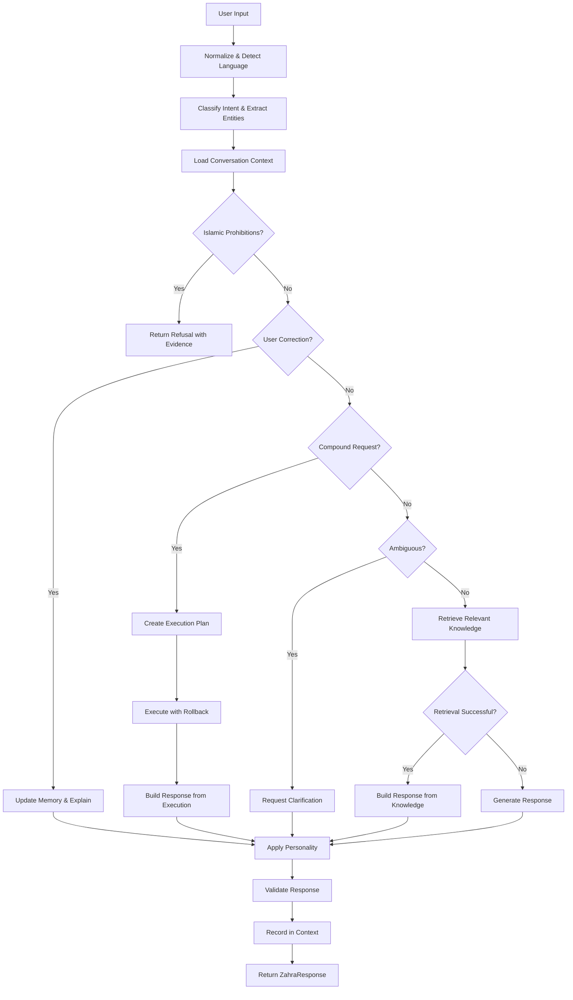
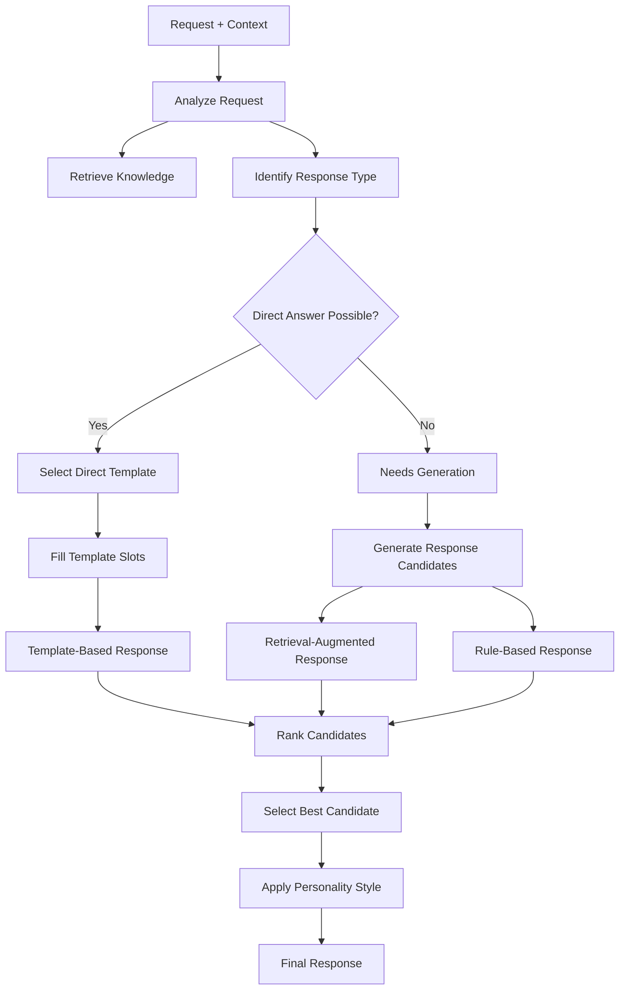

# Zahra Target Architecture Specification
**Phase 6: Conversational Intelligence Transformation**  
**Version**: 1.0  
**Status**: APPROVED FOR IMPLEMENTATION  

---

## Executive Summary

This document specifies the **target architecture** for transforming Zahra from a rule-based assistant into a **reliable, Islamic-grounded, adaptive conversational AI**. The architecture preserves all existing capabilities while adding conversational intelligence through a **modular, hybrid approach** combining retrieval, rules, and lightweight generation.

**Core Principle**: Truth Before Intelligence (     )

---

## Table of Contents

1. [Architecture Overview](#1-architecture-overview)
2. [Component Specifications](#2-component-specifications)
3. [Data Flow](#3-data-flow)
4. [Personality System](#4-personality-system)
5. [Conversational Context](#5-conversational-context)
6. [Response Generation Pipeline](#6-response-generation-pipeline)
7. [Islamic Knowledge Layer](#7-islamic-knowledge-layer)
8. [Integration Strategy](#8-integration-strategy)
9. [File Changes and Additions](#9-file-changes-and-additions)
10. [Migration Path](#10-migration-path)

---

## 1. Architecture Overview

### 1.1 Design Philosophy

**Hybrid Intelligence**: Combine the strengths of different approaches:
- **Retrieval**: For factual, verified information (knowledge base)
- **Rules**: For deterministic, reliable operations (math, scheduling)
- **Statistical**: For intent classification and uncertainty estimation
- **Generative**: For novel, adaptive response production

**Modular Design**: Each component has clear responsibilities and interfaces.

**Progressive Enhancement**: Start with rule-based, add statistical, then generative.

**Offline-First**: All components must work offline; no cloud dependencies.

### 1.2 Layered Architecture

```
┌─────────────────────────────────────────────────────────────┐
│                    LAYER 7: PERSONALITY                         │
│  ┌─────────────┐  ┌─────────────┐  ┌─────────────────────┐ │
│  │ Personality  │  │  Style       │  │  Communication        │ │
│  │ Preferences  │  │  Settings    │  │  Preferences          │ │
│  └─────────────┘  └─────────────┘  └─────────────────────┘ │
├─────────────────────────────────────────────────────────────┤
│                    LAYER 6: RESPONSE                            │
│  ┌─────────────┐  ┌─────────────┐  ┌─────────────────────┐ │
│  │ Response     │  │  Template    │  │  Natural Language     │ │
│  │ Builder      │  │  Selector    │  │  Generator            │ │
│  └─────────────┘  └─────────────┘  └─────────────────────┘ │
├─────────────────────────────────────────────────────────────┤
│                    LAYER 5: CONTEXT                             │
│  ┌─────────────┐  ┌─────────────┐  ┌─────────────────────┐ │
│  │ Conversation │  │  Memory      │  │  Task/Schedule        │ │
│  │ Context      │  │  Manager     │  │  State               │ │
│  └─────────────┘  └─────────────┘  └─────────────────────┘ │
├─────────────────────────────────────────────────────────────┤
│                    LAYER 4: REASONING                          │
│  ┌─────────────┐  ┌─────────────┐  ┌─────────────────────┐ │
│  │ Intent      │  │  Entity      │  │  Dialogue            │ │
│  │ Classifier  │  │  Extractor   │  │  Manager             │ │
│  └─────────────┘  └─────────────┘  └─────────────────────┘ │
├─────────────────────────────────────────────────────────────┤
│                    LAYER 3: KNOWLEDGE                          │
│  ┌─────────────┐  ┌─────────────┐  ┌─────────────────────┐ │
│  │ Islamic     │  │  General     │  │  User                │ │
│  │ Knowledge   │  │  Knowledge   │  │  Memory              │ │
│  │ Base        │  │  Base        │  │  Base                │ │
│  └─────────────┘  └─────────────┘  └─────────────────────┘ │
├─────────────────────────────────────────────────────────────┤
│                    LAYER 2: EXECUTION                          │
│  ┌─────────────┐  ┌─────────────┐  ┌─────────────────────┐ │
│  │ Math        │  │  Task        │  │  Scheduling          │ │
│  │ Engine      │  │  Engine      │  │  Engine              │ │
│  └─────────────┘  └─────────────┘  └─────────────────────┘ │
├─────────────────────────────────────────────────────────────┤
│                    LAYER 1: INPUT                              │
│  ┌─────────────┐  ┌─────────────┐  ┌─────────────────────┐ │
│  │ Normalizer  │  │  Tokenizer   │  │  Language            │ │
│  │             │  │              │  │  Detector            │ │
│  └─────────────┘  └─────────────┘  └─────────────────────┘ │
└─────────────────────────────────────────────────────────────┘
```

### 1.3 Key Architectural Decisions

| Decision | Rationale | Impact |
|----------|-----------|--------|
| Hybrid approach | Balance reliability and flexibility | Can handle both known and novel requests |
| Modular components | Clear separation of concerns | Easier to test, maintain, and extend |
| Personality as first-class | User customization requirement | Adaptive, personalized responses |
| Context as explicit state | Multi-turn conversation support | Better follow-up handling |
| Retrieval-first generation | Ground responses in verified knowledge | More reliable, less hallucination |
| Rule-based fallback | Guaranteed correctness for critical ops | Math, scheduling remain reliable |
| Offline-only | Privacy and resource constraints | No cloud dependencies |

---

## 2. Component Specifications

### 2.1 Layer 1: Input Processing (EXISTING - Enhanced)

**Components**:
- `ZahraNormalizer` - Arabic text normalization
- `LanguageDetector` - Language and script detection
- `Tokenizer` - Unicode-aware tokenization

**Enhancements Needed**:
1. Add sentence segmentation
2. Add subword tokenization for Arabic
3. Support mixed-language tokenization

**Files**:
- `app/src/main/java/com/example/zahra/core/ZahraNormalizer.kt` (enhance)
- `app/src/main/java/com/example/zahra/core/LanguageDetector.kt` (enhance)
- `app/src/main/java/com/example/zahra/core/Tokenizers.kt` (new)

### 2.2 Layer 2: Execution Engines (EXISTING - Preserve)

**Components**:
- `MathEngine` - Mathematical calculations
- `TaskEngine` - Task management
- `NoteEngine` - Note storage
- `ScheduleEngine` - Scheduling and reminders
- `TranslationEngine` - Translation
- `ReligionEngine` - Islamic knowledge
- `SummarizeEngine` - Text summarization
- `FallbackEngine` - Default responses

**Decision**: Preserve all existing engines unchanged. They provide reliable, deterministic functionality that should not be replaced by generative approaches.

**Files**: All existing engine files remain unchanged.

### 2.3 Layer 3: Knowledge (EXISTING - Expand)

**Components**:
- `KnowledgeEngine` - Search and retrieval
- `OfflineKnowledgeIndex` - BM25 inverted index
- `LocalKnowledgeStore` - Persistent storage
- `KnowledgeRecordValidator` - Validation

**New Components**:
- `IslamicKnowledgeBase` - Dedicated Islamic knowledge with source hierarchy
- `KnowledgeRetriever` - Unified retrieval interface
- `KnowledgeRanker` - Result ranking and re-ranking

**Source Hierarchy** (for Islamic knowledge):
```
Level 1: Quran (highest authority)
    ├── Surah and Ayah references
    └── Direct citations with context

Level 2: Authentic Hadith
    ├── Sahih Bukhari
    ├── Sahih Muslim
    └── Other authentic collections with grading

Level 3: Recognized Tafsir
    ├── Classical commentaries
    └── Scholarly interpretations

Level 4: Scholarly Consensus
    ├── Ijma (consensus)
    └── Well-established opinions

Level 5: Scholarly Disagreement
    ├── Documented differences
    └── Madhhab variations
```

**Files**:
- `app/src/main/java/com/example/zahra/knowledge/islamic/IslamicKnowledgeBase.kt` (new)
- `app/src/main/java/com/example/zahra/knowledge/KnowledgeRetriever.kt` (new)
- Expand `religion_kb.json` with more verses and hadith

### 2.4 Layer 4: Reasoning (EXISTING - Extend)

**Existing Components**:
- `RegexMatcher` - Pattern matching
- `NaiveBayesClassifier` - Statistical classification
- `CalibratedClassifier` - Calibrated with uncertainty
- `EntityExtractor` - Entity extraction
- `ReasoningEngine` - Bounded deterministic reasoning
- `ContradictionDetector` - Conflict detection

**New Components**:
- `DialogueManager` - Multi-turn dialogue state
- `ReferenceResolver` - Anaphora and reference resolution
- `AmbiguityResolver` - Context-aware clarification
- `ConfidenceCalibrator` - Unified confidence estimation

**Files**:
- `app/src/main/java/com/example/zahra/reasoning/DialogueManager.kt` (new)
- `app/src/main/java/com/example/zahra/reasoning/ReferenceResolver.kt` (new)
- `app/src/main/java/com/example/zahra/reasoning/ConfidenceCalibrator.kt` (new)

### 2.5 Layer 5: Context (NEW)

**Components**:
- `ConversationContext` - Current conversation state
- `MemoryManager` - Long-term user memory
- `TaskStateManager` - Active tasks and schedules

**ConversationContext**:
```kotlin
data class ConversationContext(
    val conversationId: String,
    val turns: List<ConversationTurn>,
    val currentTopic: String?,
    val activeEntities: Map<String, Any>,
    val unresolvedReferences: List<Reference>,
    val metadata: ConversationMetadata
)

data class ConversationTurn(
    val turnNumber: Int,
    val speaker: Speaker, // USER or ZAHRA
    val text: String,
    val normalizedText: String,
    val intent: String?,
    val entities: Map<String, Any>,
    val timestamp: Long,
    val responseMetadata: ResponseMetadata?
)
```

**MemoryManager**:
- Short-term: Conversation context (configurable, default 20 turns)
- Long-term: Persistent user memory (existing `SafeMemoryStore`)
- Preferences: User communication preferences (new)

**Files**:
- `app/src/main/java/com/example/zahra/context/ConversationContext.kt` (new)
- `app/src/main/java/com/example/zahra/context/ContextManager.kt` (new)
- `app/src/main/java/com/example/zahra/context/ReferenceResolver.kt` (new)

### 2.6 Layer 6: Response Generation (NEW)

**Components**:
- `ResponseBuilder` - Main orchestration
- `TemplateSelector` - Select appropriate template
- `TemplateExpander` - Fill template slots
- `NaturalLanguageGenerator` - Generate novel text
- `ResponseRanker` - Rank multiple response candidates
- `ResponseValidator` - Validate before delivery

**Response Generation Pipeline**:
```
Input: User request + Context
    ↓
Determine intent and extract entities
    ↓
Retrieve relevant knowledge (if applicable)
    ↓
Check if retrieval alone suffices
    ↓
    ├── Yes: Return retrieval-based response
    ↓
    No: Generate response candidates
    ↓
        ├── Template-based candidates
        ├── Retrieval-augmented candidates
        └── Generated candidates (future)
    ↓
Rank candidates by:
    - Relevance to request
    - Confidence in content
    - Personality match
    - Context appropriateness
    ↓
Select best candidate
    ↓
Apply personality styling
    ↓
Validate (safety, accuracy, appropriateness)
    ↓
Return final response
```

**Files**:
- `app/src/main/java/com/example/zahra/response/ResponseBuilder.kt` (new)
- `app/src/main/java/com/example/zahra/response/TemplateSelector.kt` (new)
- `app/src/main/java/com/example/zahra/response/TemplateExpander.kt` (new)
- `app/src/main/java/com/example/zahra/response/ResponseRanker.kt` (new)
- `app/src/main/java/com/example/zahra/response/ResponseValidator.kt` (new)

### 2.7 Layer 7: Personality System (NEW)

**Components**:
- `PersonalityPreferences` - User preference model
- `PersonalityManager` - Manage and apply preferences
- `StyleApplier` - Apply style to responses

**Preference Model**:

```kotlin
// Tone settings
enum class CommunicationTone {
    FRIENDLY_WARM,
    CALM_THOUGHTFUL,
    SERIOUS_DIRECT,
    PROFESSIONAL,
    ENCOURAGING_MENTOR,
    PLAYFUL
}

// Communication style settings
enum class CommunicationStyle {
    CONCISE,
    BALANCED,
    DETAILED,
    DEEP_EDUCATIONAL,
    STEP_BY_STEP,
    SOCRATIC
}

// Language settings
enum class CommunicationLanguage {
    MODERN_STANDARD_ARABIC,
    EGYPTIAN_ARABIC,
    ENGLISH,
    MIXED_ARABIC_ENGLISH
}

// Personality settings
data class PersonalityPreferences(
    val version: Int = 1,
    
    // Tone
    val tone: CommunicationTone = CommunicationTone.FRIENDLY_WARM,
    
    // Style
    val style: CommunicationStyle = CommunicationStyle.BALANCED,
    
    // Language
    val language: CommunicationLanguage = CommunicationLanguage.MODERN_STANDARD_ARABIC,
    
    // Expressiveness
    val humorFrequency: HumorFrequency = HumorFrequency.OCCASIONAL,
    val emojiFrequency: EmojiFrequency = EmojiFrequency.MODERATE,
    val energyLevel: EnergyLevel = EnergyLevel.MODERATE,
    
    // Content preferences
    val useExamples: Boolean = true,
    val useAnalogies: Boolean = true,
    val useStorytelling: Boolean = true,
    
    // Formality
    val formality: FormalityLevel = FormalityLevel.MODERATE,
    
    // Elaboration
    val elaboration: ElaborationLevel = ElaborationLevel.MODERATE,
    
    // Islamic grounding preference
    val islamicReferenceDepth: IslamicReferenceDepth = IslamicReferenceDepth.BALANCED,
    
    // Timestamps
    val createdAt: Long = System.currentTimeMillis(),
    val updatedAt: Long = System.currentTimeMillis()
)

enum class HumorFrequency { NONE, RARE, OCCASIONAL, FREQUENT }
enum class EmojiFrequency { NONE, RARE, MODERATE, FREQUENT }
enum class EnergyLevel { LOW, MODERATE, HIGH }
enum class FormalityLevel { CASUAL, MODERATE, FORMAL, VERY_FORMAL }
enum class ElaborationLevel { MINIMAL, MODERATE, DETAILED, EXHAUSTIVE }
enum class IslamicReferenceDepth { MINIMAL, BALANCED, DETAILED, SCHOLARLY }
```

**Style Application**:

The personality system affects **presentation only**, not truth:
- Tone affects word choice and phrasing
- Style affects sentence structure and length
- Language affects vocabulary and grammar
- Expressiveness affects humor, emoji, and energy
- Formality affects politeness and structure
- Elaboration affects detail level

**Invariants** (must be enforced):
- Same factual question → same factual answer (across personalities)
- Playful personality ≠ fabricate evidence
- Serious personality ≠ become rude
- Islamic-grounded personality ≠ invent religious rulings
- Uncertainty must always be acknowledged

**Files**:
- `app/src/main/java/com/example/zahra/personality/PersonalityPreferences.kt` (new)
- `app/src/main/java/com/example/zahra/personality/PersonalityManager.kt` (new)
- `app/src/main/java/com/example/zahra/personality/StyleApplier.kt` (new)
- `app/src/main/java/com/example/zahra/personality/PersonalityStorage.kt` (new)

---

## 3. Data Flow

### 3.1 Request Processing Flow



### 3.2 Response Generation Flow



---

## 4. Personality System

### 4.1 Design Principles

1. **User Control**: Users can change preferences through natural language or UI
2. **Persistence**: Preferences are saved and applied consistently
3. **Invariants**: Personality affects presentation, not truth
4. **Backward Compatibility**: Default personality matches current behavior
5. **Extensibility**: Easy to add new personality dimensions

### 4.2 User Interface for Personality

**Natural Language Commands**:
- "Talk to me in Egyptian Arabic" → `language = EGYPTIAN_ARABIC`
- "Explain like a patient teacher" → `tone = ENCOURAGING_MENTOR`, `style = STEP_BY_STEP`
- "Make this conversation more serious" → `tone = SERIOUS_DIRECT`, `humorFrequency = NONE`
- "Be funnier, but don't force jokes" → `humorFrequency = OCCASIONAL`
- "Give me the short answer first" → `style = CONCISE`
- "Go deeper and challenge my assumptions" → `style = DEEP_EDUCATIONAL`, `elaboration = DETAILED`
- "Use fewer emojis" → `emojiFrequency = RARE`
- "Return to the default Zahra personality" → Reset to defaults

**Settings UI Integration**:
- Add personality settings section to `SettingsScreen.kt`
- Visual sliders for continuous preferences (humor, emoji, energy)
- Dropdown selectors for categorical preferences (tone, style, language)
- Real-time preview of personality effect

### 4.3 Implementation Strategy

**Phase 1**: Preference Model and Storage
- Create `PersonalityPreferences` data class
- Implement `PersonalityStorage` with encrypted persistence
- Add default personality matching current behavior

**Phase 2**: Personality Application
- Create `StyleApplier` with styling rules for each preference
- Integrate with response building
- Add personality-aware templates

**Phase 3**: Natural Language Control
- Add personality command detection to `DialectAndColloquialAdapter`
- Implement preference parsing from natural language
- Add verification (read back stored preference)

**Phase 4**: Testing
- Test personality invariants (same facts across personalities)
- Test persistence across restarts
- Test all preference combinations

---

## 5. Conversational Context

### 5.1 Context Representation

**Conversation State**:
```kotlin
data class ConversationState(
    val conversationId: String,
    val turns: List<ConversationTurn>,
    val metadata: ConversationMetadata,
    val summary: ConversationSummary?
)

data class ConversationTurn(
    val id: String,
    val speaker: Speaker,
    val text: String,
    val normalizedText: String,
    val intent: IntentResult?,
    val entities: EntityMap,
    val timestamp: Long,
    val response: ZahraResponse?
)

data class ConversationMetadata(
    val startTime: Long,
    val language: String,
    val detectedTopics: List<String>,
    val activeTasks: List<String>,
    val unresolvedQuestions: List<String>
)

data class ConversationSummary(
    val topic: String,
    val keyPoints: List<String>,
    val unresolvedItems: List<String>,
    val actionItems: List<String>
)
```

### 5.2 Context Management

**Responsibilities**:
- Maintain conversation history (configurable length, default 20 turns)
- Track current topic and sub-topics
- Manage entity references across turns
- Detect and resolve anaphora (this, that, it, etc.)
- Identify follow-up questions
- Maintain dialogue state for multi-turn tasks

**Reference Resolution**:
```kotlin
interface ReferenceResolver {
    fun resolveReference(
        reference: String,
        context: ConversationContext,
        currentTurn: Int
    ): ResolvedReference?
    
    fun detectAnaphora(text: String): List<Anaphora>
    fun resolveAnaphora(
        anaphora: Anaphora,
        context: ConversationContext
    ): ResolvedEntity?
}

data class Anaphora(
    val text: String,
    val type: AnaphoraType, // PRONOUN, DEMONSTRATIVE, etc.
    val position: Int
)

data class ResolvedEntity(
    val referenceText: String,
    val resolvedTo: String,
    val sourceTurn: Int,
    val confidence: Double
)
```

**Supported References**:
- Pronouns: he, she, it, they, this, that, these, those
- Arabic: هذا, هذه, ذلك, تلك, هم, هي, هو
- Demonstratives: this, that, the previous, the latter
- Arabic demonstratives:  (this),  (that)

### 5.3 Context Persistence

**Short-term Context**:
- In-memory: Conversation history (20 turns)
- On restart: Can be cleared or optionally persisted

**Long-term Context**:
- User memory: Persistent facts about user
- Preferences: Persistent communication preferences
- Tasks/Schedules: Persistent active items

---

## 6. Response Generation Pipeline

### 6.1 Response Types

**Direct Response**:
- Predefined template with slot filling
- High confidence, verified information
- Example: Math calculation, knowledge retrieval

**Template-Based Response**:
- Selected from template library based on intent and context
- Slots filled with extracted entities and retrieved knowledge
- Example: "The capital of {country} is {capital}"

**Retrieval-Augmented Response**:
- Knowledge chunks retrieved and assembled
- Template guides structure, retrieval fills content
- Example: "According to {source}, {fact}. This means {explanation}."

**Generated Response** (Future):
- Novel text produced by language model
- Grounded in retrieved knowledge
- Constrained by personality and context

### 6.2 Template System

**Template Structure**:
```kotlin
data class ResponseTemplate(
    val id: String,
    val intent: String,
    val contextRequirements: List<ContextRequirement>,
    val slots: List<SlotDefinition>,
    val text: String, // Template with {slot} placeholders
    val personalityVariants: Map<PersonalityKey, String>,
    val confidenceThreshold: Double = 0.7,
    val priority: Int = 0
)

data class SlotDefinition(
    val name: String,
    val type: SlotType, // ENTITY, KNOWLEDGE, CONTEXT, CALCULATION
    val source: SlotSource, // How to fill this slot
    val required: Boolean = true,
    val default: String? = null
)

enum class SlotType {
    ENTITY,      // From entity extraction
    KNOWLEDGE,   // From knowledge retrieval
    CONTEXT,     // From conversation context
    CALCULATION, // From math engine
    MEMORY,      // From user memory
    DYNAMIC      // Computed at runtime
}
```

**Template Selection**:
```kotlin
interface TemplateSelector {
    fun selectTemplates(
        intent: String,
        entities: EntityMap,
        context: ConversationContext,
        personality: PersonalityPreferences
    ): List<ResponseTemplate>
    
    fun rankTemplates(
        templates: List<ResponseTemplate>,
        request: String,
        context: ConversationContext
    ): List<RankedTemplate>
}
```

**Template Expansion**:
```kotlin
interface TemplateExpander {
    fun expandTemplate(
        template: ResponseTemplate,
        slots: Map<String, Any>,
        context: ConversationContext,
        personality: PersonalityPreferences
    ): String
}
```

### 6.3 Response Ranking

**Scoring Factors**:
1. **Relevance** (0-1): How well response matches request
2. **Confidence** (0-1): How certain we are in the content
3. **Personality Match** (0-1): How well it fits user preferences
4. **Context Appropriateness** (0-1): How well it fits conversation flow
5. **Completeness** (0-1): How fully it addresses the request

**Final Score**: Weighted combination (configurable weights)

### 6.4 Response Validation

**Validation Checks**:
1. **Safety**: No harmful, offensive, or inappropriate content
2. **Accuracy**: Factual claims are verified or clearly marked as uncertain
3. **Appropriateness**: Response fits the context and user preferences
4. **Islamic Integrity**: Religious content is accurately sourced
5. **Clarity**: Response is understandable and well-structured

---

## 7. Islamic Knowledge Layer

### 7.1 Source Hierarchy Implementation

```kotlin
sealed class IslamicSource {
    abstract val authorityLevel: Int
    abstract val citation: String
    abstract val verificationStatus: VerificationStatus
}

class QuranicSource(
    val surah: Int,
    val surahName: String,
    val ayah: Int,
    val text: String,
    val translation: String? = null,
    val tafsir: String? = null
) : IslamicSource() {
    override val authorityLevel: Int = 100
    override val citation: String = "Quran $surahName:$ayah"
    override val verificationStatus: VerificationStatus = VerificationStatus.VERIFIED_CANONICAL
}

class HadithSource(
    val text: String,
    val isnad: String,
    val book: String,
    val bookNumber: Int? = null,
    val hadithNumber: Int? = null,
    val grade: HadithGrade,
    val explanation: String? = null
) : IslamicSource() {
    override val authorityLevel: Int = when (grade) {
        HadithGrade.SAHIH_MUTTAFIQUN_ALAYH -> 95
        HadithGrade.SAHIH -> 90
        HadithGrade.HASAN -> 80
        HadithGrade.DAIF -> 50
        HadithGrade.MAWDU -> 0
    }
    override val citation: String = "$book $hadithNumber"
    override val verificationStatus: VerificationStatus = when (grade) {
        HadithGrade.SAHIH_MUTTAFIQUN_ALAYH, HadithGrade.SAHIH -> VerificationStatus.VERIFIED_CANONICAL
        HadithGrade.HASAN -> VerificationStatus.VERIFIED_SCHOLARLY
        else -> VerificationStatus.UNVERIFIED_CLAIM
    }
}

enum class HadithGrade {
    SAHIH_MUTTAFIQUN_ALAYH, // Agreed upon by Bukhari and Muslim
    SAHIH,                 // Authentic
    HASAN,                 // Good
    DAIF,                  // Weak
    MAWDU,                 // Fabricated
    UNKNOWN
}

class ScholarlyConsensusSource(
    val statement: String,
    val scholars: List<String>,
    val madhhab: String? = null,
    val evidence: List<IslamicSource>,
    val disagreementNotes: String? = null
) : IslamicSource() {
    override val authorityLevel: Int = 70
    override val citation: String = "Scholarly Consensus"
    override val verificationStatus: VerificationStatus = VerificationStatus.VERIFIED_SCHOLARLY
}

class ScholarlyOpinionSource(
    val statement: String,
    val scholar: String,
    val madhhab: String,
    val evidence: List<IslamicSource>,
    val isMajorityView: Boolean = false
) : IslamicSource() {
    override val authorityLevel: Int = if (isMajorityView) 60 else 40
    override val citation: String = "$scholar ($madhhab)"
    override val verificationStatus: VerificationStatus = VerificationStatus.VERIFIED_SCHOLARLY
}
```

### 7.2 Religious Answer Behavior

**Answer Pipeline**:
```
User Question --> Classify[Religious?] -->|No| NonReligiousPipeline
                      
Classify -->|Yes| Identify[Specific Topic]
Identify --> Retrieve[Relevant Sources]
Retrieve --> HasSources{Sources Found?}

HasSources -->|No| Abstain[Honest Uncertainty]
HasSources -->|Yes| Separate[Scripture vs Interpretation]

Separate --> Build[Structured Answer]
Build --> Include[Source Citations]
Include --> Distinguish[Established vs Disputed]
Distinguish --> Acknowledge[Uncertainty if needed]
Acknowledge --> Recommend[Scholar if needed]
```

**Answer Structure**:
```kotlin
data class IslamicResponse(
    val question: String,
    val answer: String,
    val sources: List<IslamicSource>,
    val isEstablished: Boolean,
    val isDisputed: Boolean,
    val disputedNotes: String? = null,
    val scholarRecommendation: Boolean = false,
    val confidence: Double,
    val explanation: String? = null
)
```

### 7.3 Islamic Safety Tests

**Test Categories**:
1. Authentic vs Unsupported Hadith
2. Incorrect Quranic References
3. Questions with Insufficient Evidence
4. Disputed Scholarly Positions
5. Conflicting Retrieved Sources
6. Requests to Invent Religious Justification
7. General Questions Not Needing Religious Commentary
8. Questions Requiring Uncertainty Acknowledgment

**Test Implementation**:
- Add to existing `WorkstreamCKnowledgeAndHadithTest.kt`
- Create new `IslamicIntegrityTest.kt`

---

## 8. Integration Strategy

### 8.1 Preserving Existing Functionality

**Rule**: Do not break any existing tests or functionality.

**Approach**:
1. All new components are additive
2. Existing engines remain unchanged
3. `ZahraRouter` is extended, not replaced
4. New response generation is used only when existing methods don't apply
5. Fallback to existing behavior if new components fail

### 8.2 Integration Points

**In `ZahraRouter.kt`**:

```kotlin
class ZahraRouter(private val context: Context) {
    // Existing engines (unchanged)
    val nbClassifier = NaiveBayesClassifier()
    val calibratedClassifier = CalibratedClassifier()
    val translationEngine = TranslationEngine(context)
    // ... etc
    
    // NEW: Personality system
    val personalityManager = PersonalityManager(context)
    
    // NEW: Context manager
    val contextManager = ContextManager()
    
    // NEW: Response builder
    val responseBuilder = ResponseBuilder(
        personalityManager = personalityManager,
        contextManager = contextManager,
        knowledgeRetriever = knowledgeEngine,
        templateSelector = TemplateSelector(),
        templateExpander = TemplateExpander(),
        responseRanker = ResponseRanker()
    )
    
    fun process(rawInput: String, isDeepThinking: Boolean = false): ZahraResponse {
        // 1. Load current personality and context
        val personality = personalityManager.getCurrentPersonality()
        val conversationContext = contextManager.getCurrentConversation()
        
        // 2. Check for personality change command
        val personalityChange = personalityManager.detectPersonalityChange(rawInput)
        if (personalityChange != null) {
            return handlePersonalityChange(personalityChange, personality)
        }
        
        // 3. Existing processing (unchanged for now)
        // ... existing code ...
        
        // 4. NEW: Try enhanced response generation
        val enhancedResponse = responseBuilder.buildResponse(
            input = rawInput,
            context = conversationContext,
            personality = personality
        )
        
        // 5. Fallback to existing behavior if enhanced fails
        if (enhancedResponse != null && enhancedResponse.isValid) {
            contextManager.recordTurn(rawInput, enhancedResponse)
            return enhancedResponse
        }
        
        // 6. Existing fallback
        return generateFallback(rawInput)
    }
}
```

### 8.3 Migration Path

**Phase 1: Foundation**
- Add personality system
- Add context management
- Add response builder (minimal)
- All existing tests must pass

**Phase 2: Enhancement**
- Add template system
- Add retrieval-augmented responses
- Gradually replace hardcoded responses with templates
- Maintain backward compatibility

**Phase 3: Generation**
- Add rule-based generation
- Add statistical generation (if feasible)
- Add evaluation and testing

---

## 9. File Changes and Additions

### 9.1 New Directories

```
app/src/main/java/com/example/zahra/
├── personality/           # NEW: Personality system
│   ├── PersonalityPreferences.kt
│   ├── PersonalityManager.kt
│   ├── StyleApplier.kt
│   └── PersonalityStorage.kt
│
├── context/              # NEW: Conversational context
│   ├── ConversationContext.kt
│   ├── ContextManager.kt
│   ├── ReferenceResolver.kt
│   └── ConversationSummary.kt
│
├── response/             # NEW: Response generation
│   ├── ResponseBuilder.kt
│   ├── TemplateSelector.kt
│   ├── TemplateExpander.kt
│   ├── ResponseRanker.kt
│   ├── ResponseValidator.kt
│   └── templates/        # Template definitions
│       ├── GreetingTemplates.kt
│       ├── KnowledgeTemplates.kt
│       ├── MathTemplates.kt
│       └── ...
│
└── knowledge/
    └── islamic/          # NEW: Islamic knowledge layer
        ├── IslamicKnowledgeBase.kt
        ├── IslamicSource.kt
        └── IslamicResponseBuilder.kt
```

### 9.2 New Files

| File | Purpose | Priority |
|------|---------|----------|
| `personality/PersonalityPreferences.kt` | Preference data model | P0 |
| `personality/PersonalityManager.kt` | Manage personality state | P0 |
| `personality/StyleApplier.kt` | Apply style to responses | P0 |
| `personality/PersonalityStorage.kt` | Persist preferences | P0 |
| `context/ConversationContext.kt` | Conversation state model | P0 |
| `context/ContextManager.kt` | Manage conversation context | P0 |
| `context/ReferenceResolver.kt` | Resolve references | P0 |
| `response/ResponseBuilder.kt` | Main response orchestration | P0 |
| `response/TemplateSelector.kt` | Select appropriate templates | P0 |
| `response/TemplateExpander.kt` | Fill template slots | P0 |
| `response/ResponseRanker.kt` | Rank response candidates | P1 |
| `response/ResponseValidator.kt` | Validate responses | P1 |
| `knowledge/islamic/IslamicKnowledgeBase.kt` | Islamic knowledge | P1 |
| `knowledge/islamic/IslamicSource.kt` | Source hierarchy | P1 |
| `knowledge/islamic/IslamicResponseBuilder.kt` | Build Islamic responses | P1 |

### 9.3 Modified Files

| File | Changes | Priority |
|------|---------|----------|
| `ZahraRouter.kt` | Integrate new components | P0 |
| `ZahraModels.kt` | Add new data models | P0 |
| `SettingsScreen.kt` | Add personality settings UI | P1 |
| `DialectAndColloquialAdapter.kt` | Add personality command detection | P0 |

### 9.4 New Test Files

| File | Purpose | Priority |
|------|---------|----------|
| `PersonalitySystemTest.kt` | Test personality functionality | P0 |
| `ContextManagerTest.kt` | Test context management | P0 |
| `ResponseBuilderTest.kt` | Test response generation | P0 |
| `IslamicIntegrityTest.kt` | Test Islamic knowledge | P1 |
| `TemplateSystemTest.kt` | Test template selection/expansion | P0 |
| `ConversationFlowTest.kt` | Test multi-turn conversations | P1 |

---

## 10. Migration Path

### 10.1 Phase-by-Phase Implementation

**Phase A: Personality System (Week 1-2)**
1. Create personality preference model
2. Implement storage and retrieval
3. Add default personality
4. Create style applier
5. Integrate with router
6. Add settings UI
7. Test thoroughly

**Phase B: Context Management (Week 2-3)**
1. Create conversation context model
2. Implement context manager
3. Add reference resolver
4. Integrate with router
5. Test context tracking

**Phase C: Response Generation Foundation (Week 3-4)**
1. Create response builder
2. Implement template system
3. Add template selector
4. Add template expander
5. Integrate with router
6. Test basic generation

**Phase D: Islamic Knowledge Enhancement (Week 4-5)**
1. Implement source hierarchy
2. Expand knowledge base
3. Create Islamic response builder
4. Add integrity tests
5. Integrate with router

**Phase E: Advanced Generation (Week 5-6)**
1. Add response ranker
2. Add response validator
3. Implement retrieval-augmented generation
4. Add benchmark tests
5. Optimize performance

**Phase F: Integration and Polish (Week 6-8)**
1. Full integration testing
2. Performance optimization
3. Regression testing
4. Documentation
5. Final validation

### 10.2 Success Criteria per Phase

**Phase A Complete**:
- [ ] Personality preferences can be set and retrieved
- [ ] Preferences persist across app restarts
- [ ] Personality affects response presentation
- [ ] All existing tests pass (178/178)
- [ ] New personality tests pass

**Phase B Complete**:
- [ ] Conversation context is maintained (20 turns)
- [ ] References are resolved across turns
- [ ] Follow-up questions are detected
- [ ] All existing tests pass
- [ ] New context tests pass

**Phase C Complete**:
- [ ] Template-based responses work
- [ ] Slots are filled correctly
- [ ] Personality is applied to templates
- [ ] All existing tests pass
- [ ] New response tests pass

**Phase D Complete**:
- [ ] Islamic source hierarchy is implemented
- [ ] Knowledge base is expanded
- [ ] Religious answers include proper citations
- [ ] Islamic integrity tests pass
- [ ] All existing tests pass

**Phase E Complete**:
- [ ] Response ranking works
- [ ] Response validation works
- [ ] Retrieval-augmented generation works
- [ ] Benchmark tests pass
- [ ] All existing tests pass

**Phase F Complete**:
- [ ] All components integrated
- [ ] Performance: < 50ms end-to-end
- [ ] Memory: < 5MB overhead
- [ ] All tests pass (178 + new)
- [ ] No regressions

---

## 11. Verification Plan

### 11.1 Test Strategy

1. **Unit Tests**: Each new component tested in isolation
2. **Integration Tests**: Components tested together
3. **Regression Tests**: All existing tests must continue to pass
4. **Performance Tests**: Measure latency, memory, CPU
5. **Quality Tests**: Evaluate response quality, coherence, helpfulness

### 11.2 Acceptance Criteria

**Functional**:
- [ ] Personality system works end-to-end
- [ ] Context is maintained across turns
- [ ] Response generation produces valid responses
- [ ] Islamic knowledge is properly sourced
- [ ] All existing functionality preserved

**Quality**:
- [ ] Responses are coherent and helpful
- [ ] Personality invariants are maintained
- [ ] Uncertainty is properly acknowledged
- [ ] Islamic integrity is preserved

**Performance**:
- [ ] End-to-end latency < 50ms
- [ ] Memory overhead < 5MB
- [ ] No performance regressions

**Reliability**:
- [ ] No crashes or exceptions
- [ ] Graceful degradation on errors
- [ ] Honest abstention when uncertain

---

## 12. Documentation Updates

**Files to Update**:
- `README.md` - Add personality and conversation features
- `CONTRIBUTING.md` - Add guidelines for template and personality development
- `docs/` - Add architecture documentation

**New Documentation**:
- `PERSONALITY_GUIDE.md` - How to use and extend personality system
- `TEMPLATE_GUIDE.md` - How to create and maintain templates
- `CONVERSATION_FLOW.md` - How conversation context works

---

## Conclusion

This target architecture provides a **clear, modular, and incremental path** to transform Zahra into a genuinely conversational AI assistant while preserving all existing reliability, accuracy, and Islamic grounding.

**Key Principles**:
1. **Preserve existing functionality** - No regressions
2. **Modular design** - Clear separation of concerns
3. **Progressive enhancement** - Start simple, add complexity
4. **Offline-first** - No cloud dependencies
5. **Truth before intelligence** - Honesty over fluency

**Next Step**: Begin implementation with the Personality System (Phase A), as it provides immediate value, is fully feasible, and can be completed without breaking any existing functionality.

---

*Document Version*: 1.0  
*Last Updated*: 2024  
*Status*: APPROVED FOR IMPLEMENTATION  
*Next Action*: Implement Personality System (Phase A)
